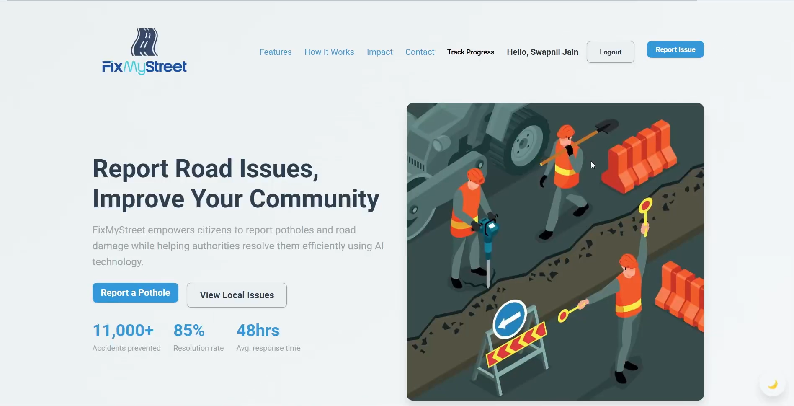
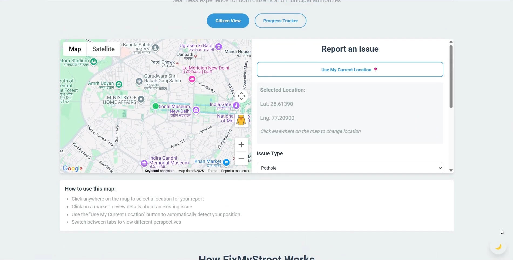
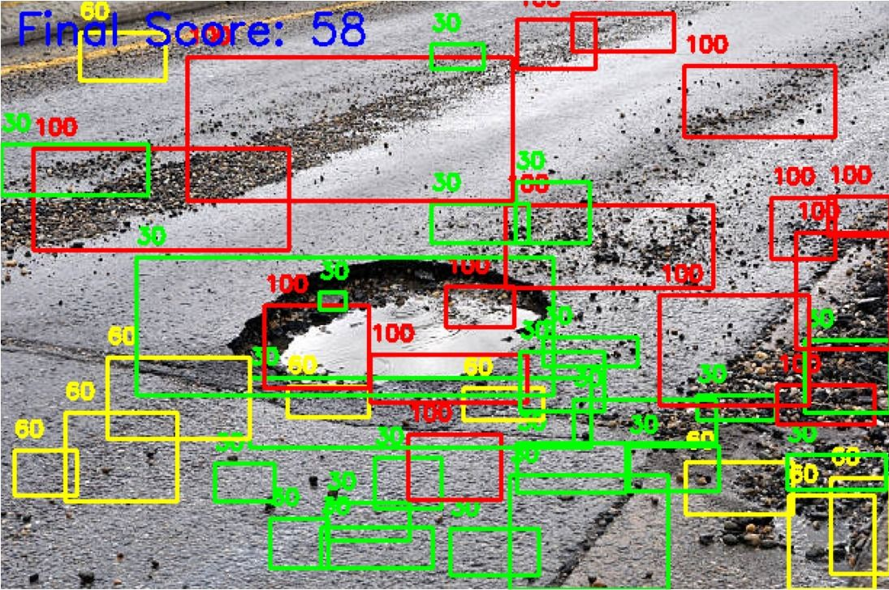
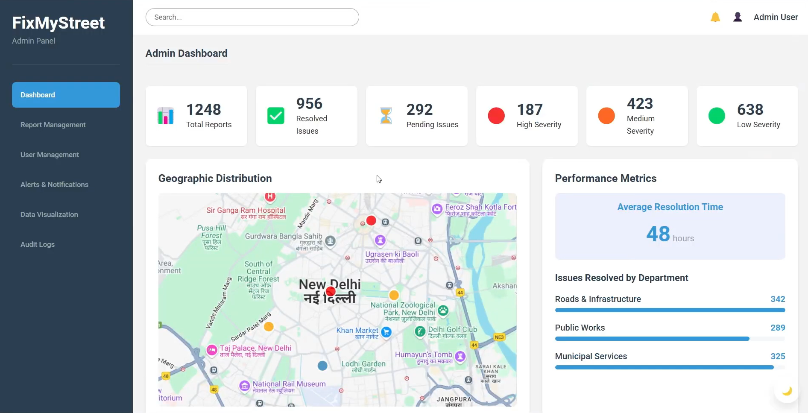
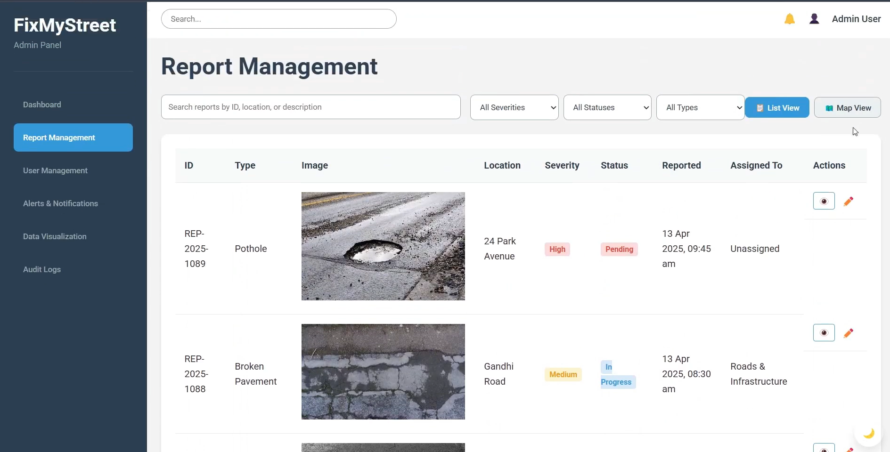

# FixMyStreet

🏆 Winner, ESOC-X-Hack, IIIT Nagpur (1st among 100+ participants)

FixMyStreet is a civic tech platform that lets citizens report road issues such as potholes and damaged pavements. Each geotagged report is analyzed by a computer vision pipeline (OpenCV region detection + an SVM classifier) that estimates damage severity, so authorities can prioritize repairs through an admin dashboard.

Built with React, Laravel, MySQL, and a Python / Flask / OpenCV / scikit-learn analysis service.

▶ [Watch the demo video](https://drive.google.com/file/d/1EXyZ0hCmUG-F93n3FsfIFsMYSN9HuNz9/view?usp=drive_link)

---

## Screenshots

▶ [Watch the demo video](https://drive.google.com/file/d/1EXyZ0hCmUG-F93n3FsfIFsMYSN9HuNz9/view?usp=drive_link)

### Homepage / Issue Reporting


### Geotagged Complaint Form


### Pothole Detection Result


### Admin Dashboard (Complaint Tracker)


### Report Log (Admin)


---

## Table of Contents

- [Overview](#overview)
- [Features](#features)
- [Tech Stack](#tech-stack)
- [Architecture](#architecture)
- [ML Pipeline](#ml-pipeline)
- [Project Structure](#project-structure)
- [Installation](#installation)
- [Limitations](#limitations)
- [Future Roadmap](#future-roadmap)
- [Contributors](#contributors)
- [Screenshots](#screenshots)

---

## Overview

India suffers thousands of casualties annually due to poor road conditions. Citizens lack an efficient way to report these problems, and authorities find it hard to prioritize repairs because the data is inconsistent.

FixMyStreet addresses this by providing:

- 🗺️ A platform for reporting road damage with geotagged images
- 🧠 Automated damage detection and severity scoring using OpenCV and an SVM classifier
- 📊 An admin dashboard for authorities to review and manage complaints
- 📬 Status updates for complainants

---

## Features

- 📸 **Image-based reporting:** Upload photos of road damage along with real-time GPS coordinates.
- 🤖 **Automated severity scoring:** Each uploaded image is processed to generate damage bounding boxes, an overall score, and a severity tier (`low`, `medium`, `high`).
- 📊 **Admin dashboard & report log:** Review, prioritize, and filter complaints with map markers and stage metrics (tested with interactive simulation data).
- 🔐 **Role-based views:** Citizen reporting interface alongside administrative management views with backend schema support.
- 🧾 **Data logging:** Complaints, geographic locations, and AI-assessed severities are persisted in MySQL/SQLite for auditability.

---

## Tech Stack

| Layer | Technology |
| :--- | :--- |
| **Frontend** | React, React Router, Lucide Icons, Recharts, Google Maps API |
| **Backend** | Laravel (PHP), MySQL / SQLite, Guzzle HTTP |
| **ML / Image Processing** | Python, Flask, OpenCV, scikit-learn, NumPy, joblib |
| **Tooling & Versioning** | Git, GitHub |

---

## Architecture

```text
User (React frontend)
          ↓ (Report with image + GPS location)
Backend API (Laravel)
          ↓ (POST /analyze with multipart image via Guzzle)
Analysis Service (Flask: OpenCV region detection → SVC patch classification)
          ↓ (Damage regions + final score + severity)
Database (MySQL / SQLite)
          ↓
Admin Dashboard & Complaint Tracking
```

If the analysis service is unavailable, Laravel gracefully catches the exception, logs the event, and saves the complaint with a default severity of `low` and a score of `0`.

---

## ML Pipeline

The analysis service (`backend/ai/pothole_detection/app.py`) combines classical computer vision with a trained classifier.

### 1. Candidate Region Detection (OpenCV)
- Convert the image to grayscale and apply a $5 \times 5$ Gaussian blur.
- Detect edges with Canny edge detection (thresholds 50 / 150).
- Find external contours and discard those with an area below 100 pixels.
- Crop a bounding box around each remaining contour as a candidate damage patch.

### 2. Feature Extraction (per patch, 513 features)
- Resize each cropped patch to $64 \times 64$ pixels.
- **Edge Density (1 feature):** Canny edge detection (thresholds 100 / 200) divided by total patch pixel area.
- **Color Histogram (512 features):** 3D BGR color histogram with $8 \times 8 \times 8$ bins (`cv2.calcHist`).
- Stacks edge density and color histogram into a 513-dimensional feature vector.

### 3. Classification (scikit-learn)
- **Model:** Support Vector Classifier (`sklearn.svm.SVC`, linear kernel, `probability=True`), saved as `road_damage_model.pkl`.
- **Output:** Predicts a damage tier per patch (`0`, `1`, or `2`), mapped to scores of `30`, `60`, and `100`.

### 4. Severity Aggregation
- Final score is the arithmetic mean of all detected patch scores.
- Score $\ge 50 \rightarrow$ **high**, $\ge 20 \rightarrow$ **medium**, otherwise **low** (also low if no candidate damage regions are detected).

**Example Response (`POST /analyze`):**
```json
{
  "damage_detected": true,
  "damage_count": 2,
  "damage_regions": [
    {
      "coordinates": [120, 85, 240, 195],
      "damage_level": 1,
      "score": 60
    }
  ],
  "final_score": 60,
  "severity": "high"
}
```

*Note on Evaluation:* The original raw training images and training script were external and are not retained in this repository. Held-out benchmark metrics are therefore omitted until a formal benchmark set is evaluated.

---

## Project Structure

```text
FixMyStreet/
├── backend/                     # Laravel backend API & database
│   └── ai/pothole_detection/    # Flask AI service (app.py, road_damage_model.pkl, requirements.txt)
├── frontend/                    # React frontend application
├── docs/
│   └── screenshots/             # Application screenshots & media
├── .gitignore
└── README.md
```

---

## Installation

### Prerequisites
- Node.js (v16+) & npm
- PHP (v8.2+) & Composer
- Python (3.10+)
- MySQL Server or SQLite

---

### Frontend

```bash
cd frontend
cp .env.example .env
```

Configure your Google Maps API keys in `.env`:
```env
REACT_APP_GOOGLE_MAPS_API_KEY=your_google_maps_api_key_here
REACT_APP_ADMIN_GOOGLE_MAPS_API_KEY=your_admin_google_maps_api_key_here
```

Install packages and start the React development server:
```bash
npm install
npm start
```
The frontend will run at `http://localhost:3000`.

---

### Backend (Laravel)

```bash
cd backend
composer install
cp .env.example .env
php artisan key:generate
php artisan migrate
php artisan serve
```
The backend API will run at `http://localhost:8000`.

---

### Analysis Service (Flask)

```bash
cd backend/ai/pothole_detection
pip install -r requirements.txt
python app.py
```
The AI service listens on `http://127.0.0.1:5000`.

> **Note:** Run `python app.py` from inside `backend/ai/pothole_detection/`, because `road_damage_model.pkl` is resolved relative to the current working directory.

---

## Limitations

- The classifier relies on handcrafted features (edge density and color histograms), which may fluctuate under varied lighting conditions, rain reflections, or shadows.
- Region proposals use edge detection and contour area thresholds; non-damage road artifacts (e.g. tar lines, fallen leaves) can occasionally be proposed.
- Depth estimation cannot be directly measured from standard 2D monocular images.
- The model was saved with scikit-learn 1.1.3; loading it in scikit-learn 1.6+ emits an `InconsistentVersionWarning`.
- The admin dashboard data display was developed and verified using representative simulation records.

---

## Future Roadmap

- 🧪 Benchmark against a public road damage dataset (e.g. RDD2022) with precision/recall curves.
- 🔁 Add an end-to-end automated training script with dataset versioning.
- 🤖 Compare the classical SVM approach against lightweight YOLO object detection models.
- 🔦 Expand issue reporting to streetlights, open manholes, and urban waterlogging.
- 🗺️ Heatmap clustering for municipal repair route optimization.
- 💬 Multilingual localization for regional languages.
- 📱 Native mobile client (React Native / Flutter).

---

## Contributors

| Name | GitHub |
| :--- | :--- |
| **Arnab Mistry** | [@ArnabMistry](https://github.com/ArnabMistry) |
| **Swapnil Jain** | [@Swapnil220705](https://github.com/Swapnil220705) |
| **Arnav Timble** | [@Arnz18](https://github.com/Arnz18) |
| **Ojaswi Joshi** | [@OjaswiJoshi13](https://github.com/OjaswiJoshi13) |
